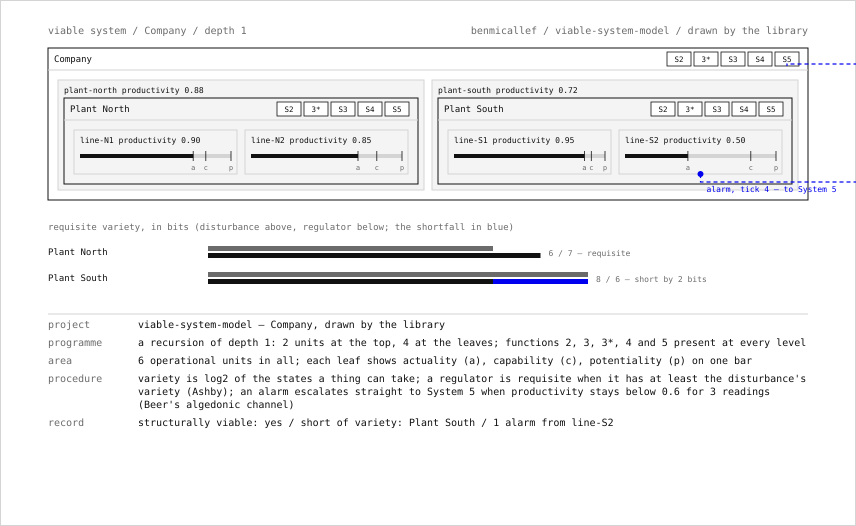

# viable-system-model

An executable, cited model of Stafford Beer's Viable System Model, with Ashby's variety mathematics done exactly. A small, typed, zero-dependency Python library: Systems 1–5 and the recursion as a checkable structure, the Law of Requisite Variety as arithmetic over stipulated state spaces, Beer's variety-engineering loop, his channel principles, and a deterministic algedonic (pain/pleasure) alarm channel, all with a test suite that pins the properties.

```bash
pip install -e ".[dev]"
python -m vsm demo
pytest -q && mypy && ruff check .
```

## What it is

Beer's claim, worked out across *Brain of the Firm* (1972), *The Heart of Enterprise* (1979) and *Diagnosing the System for Organizations* (1985), is that any organization able to keep itself going has five necessary functions (the operations that do the work, their coordination, internal regulation with a sporadic audit, intelligence about the outside and the future, and policy) and that each operational unit is itself such a system. The whole edifice rests on Ashby's Law of Requisite Variety: a regulator can only match a disturbance if it commands at least as many distinguishable states.

`vsm` turns that into things you can run and test:

- **`vsm.variety`**: `variety(states)` in bits; `requisite(D, R)` returning whether the regulator is requisite and the residual outcome variety `max(0, D − R)`; `Attenuator` and `Amplifier` as composable bit-transforms; `balance(...)` for Beer's loop of attenuating the environment and amplifying the response until the pair balances.
- **`vsm.channel`**: a `Channel` with capacity, and `channel_violations(...)` for Beer's inequalities on channels and transducers.
- **`vsm.system`**: `ViableSystem`, `System1`, `Metrics`. A unit with a `subsystem` is itself a viable system; `is_structurally_viable()` checks every level of the recursion.
- **`vsm.algedonic`**: `propagate(root, readings, threshold=…, timeout=…)` emits an `AlgedonicEvent` when a unit's productivity stays below threshold for a run of readings, escalating straight up the recursion to System 5.
- **`vsm.render`**, **`python -m vsm demo`**: deterministic ASCII rendering of the tree, the variety tables and the alarm trace, from a bundled three-level factory.

[`THEORY.md`](THEORY.md) maps every construct to its page in Ashby or Beer, and marks the one place the code goes beyond them.

## What this can and cannot prove

**It can** demonstrate the internal logic of the VSM as Beer specified it; compute Ashby's variety and the requisite-variety inequality *exactly* over a finite state space you stipulate (those outputs are mathematical facts); show, by test, that an algedonic alarm propagates up the recursion exactly when the model's own rule says it should; and serve as an executable, cited glossary of cybernetic regulation.

**It cannot** prove any real organization is viable, or predict its behaviour. The VSM is a normative, diagnostic framework, and its standing as a theory of organizations is contested in management science. It does not measure the variety of a real environment or organization. That estimation is the hard step, and this library deliberately leaves it to you. It controls no robot and runs on no hardware; its relevance to autonomy is conceptual: feedback regulation, requisite variety, hierarchical control with sporadic audit, and the escalation of faults. And the algedonic rule here (a threshold held for a timeout) is my operationalization. Beer described the channel; he did not write the algorithm.

## The demo

```
Company  [S2 S3 S3* S4 S5]
|- plant-north  productivity 0.88  [S2 S3 S3* S4 S5]
|  |- line-N1  productivity 0.90
|  `- line-N2  productivity 0.85
`- plant-south  productivity 0.72  [S2 S3 S3* S4 S5]
   |- line-S1  productivity 0.95
   `- line-S2  productivity 0.50
structurally viable: yes  (depth 1)

REQUISITE VARIETY (Ashby), per plant
unit         disturbance  regulator  requisite  deficit
Plant North         6.00       7.00        yes     0.00
Plant South         8.00       6.00        NO      2.00

VARIETY ENGINEERING (Beer) on Plant South
unit    disturbance  regulator  requisite  deficit
before         8.00       6.00        NO      2.00
after          6.50       7.00        yes     0.00
attenuate the environment by 1.5 bits, amplify the regulator by 1.0 bit

ALGEDONIC CHANNEL  threshold 0.6  timeout 3 readings
ALGEDONIC  t=4  line-S2  productivity 0.47  via Plant South -> Company
```

## The sheet

`vsm.sheet.sheet(root, requisite_rows, events)` draws a model as an SVG sheet from the same objects the text renderer reports: each viable system as a frame carrying its functions 2, 3, 3*, 4 and 5 (a missing one marked in the accent), its operational units side by side with any nested system drawn inside them, one bar per leaf for actuality, capability and potentiality, the requisite-variety test per named system as two bars with the shortfall in the accent, and every alarm as a dashed route from its unit straight to System 5. The title block is in the scenario format. `scripts/make_docs.py` writes it to [`docs/vsm.svg`](docs/vsm.svg) beside the page.



## Tests

`pytest` runs unit tests plus two Hypothesis property tests: that `requisite` satisfies Ashby's bound for all non-negative inputs, and that `propagate` emits exactly one alarm per maximal run of low readings of length at least the timeout, checked against an independent counter. `mypy --strict` and `ruff` run in CI across Python 3.11–3.13.

## Cybersyn, as context

Beer tried to run part of a real economy on these ideas: Project Cybersyn in Chile, 1971–73, under Salvador Allende, with Chilean engineers including Fernando Flores and Raúl Espejo: a telex network from factories to a Santiago operations room. It was unfinished when the coup of 11 September 1973 ended it, and assessments of it remain contested. Eden Medina's *Cybernetic Revolutionaries* (2011) is the account to read. It belongs here as history, not as evidence that the model works.

## Why this sits with the rest

The same thread runs through the other projects in this set: Grey Walter's reflex tortoise, Pask's conversational mobiles, a stigmergic construction swarm, and an on-device sign runtime. Beer is the one who took the loop out of the laboratory and asked what it demands of an institution. Requisite variety is the question every autonomous system has to answer about its own controller.

## License

MIT. See [`LICENSE`](LICENSE).
